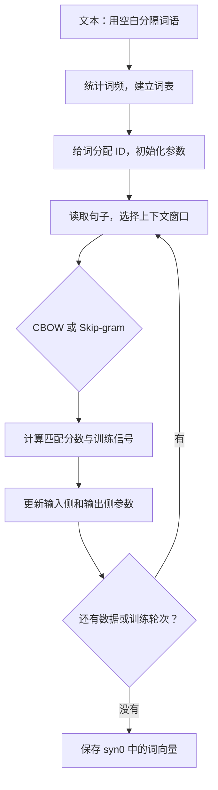

# Word2Vec 源码阅读指南：从输入文本到词向量

面向第一次阅读 C 语言机器学习代码的学习者。目标是理解数据流和训练过程，再逐步阅读实现细节。

对应论文：[Efficient Estimation of Word Representations in Vector Space](../01_Word2Vec_2013.pdf)。对应源码：[word2vec.c](word2vec/word2vec.c)，作者仓库为 [tmikolov/word2vec](https://github.com/tmikolov/word2vec)，收录提交为 `20c129af10659f7c50e86e3be406df663beff438`。正文行号指上游未注释版本；源码跳转链接已调整到当前中文注释版。可优先按函数名定位。

## 1. 先理解程序在做什么

输入是一份已经用空白分隔词语的文本。例如：

```text
我 喜欢 看 电影
我 喜欢 看 小说
```

程序通过上下文预测任务调整参数，最终输出每个词的向量。它不直接输出整句话的向量，也不会自动判断情感。



这里的“预测”不一定是在整个词表上算出一个完整概率分布。使用负采样时，程序学习的是：区分真实词对和抽样得到的负词对。

## 2. 阅读顺序：不要从文件第一行硬读到最后一行

| 顺序 | 函数或位置 | 源码行号 | 先回答的问题 |
| --- | --- | --- | --- |
| 1 | `main` | [640](word2vec/word2vec.c#L728) | 用户如何指定语料、维度和训练模式？ |
| 2 | `TrainModel` | [557](word2vec/word2vec.c#L634) | 训练前后分别做了什么？ |
| 3 | `LearnVocabFromTrainFile` | [272](word2vec/word2vec.c#L303) | 文本如何变成词表？ |
| 4 | `InitNet` | [350](word2vec/word2vec.c#L385) | 向量在哪里创建、如何初始化？ |
| 5 | `TrainModelThread` | [374](word2vec/word2vec.c#L413) | 如何取上下文、计算分数和更新参数？ |
| 6 | 保存向量的循环 | [572](word2vec/word2vec.c#L653) | 最后保存的是哪组参数？ |

第一遍先看 `-threads 1 -hs 0 -negative 5` 对应的路径；哈希表、Huffman 树、多线程和聚类输出可以放到后面。

## 3. 看懂 C 语言所需的最小知识

| 写法 | 含义 | 在这里的用途 |
| --- | --- | --- |
| `int` / `long long` | 整数类型 | 词 ID、词频、循环计数 |
| `real` | 本程序用 `typedef float real` 定义的浮点类型 | 存放向量分量 |
| `real *syn0` | 指向一段浮点数据的指针 | 访问词向量矩阵的存储空间 |
| `syn0[i]` | 访问第 i 个元素，下标从 0 开始 | 取出一个向量分量 |
| `vocab[word].cn` | 访问第 word 个词的 `cn` 字段 | 获取这个词的出现次数 |
| `for (...)` | 循环执行 | 遍历词、上下文或向量维度 |
| `if (...)` / `else` | 条件分支 | 选择 CBOW 或 Skip-gram |
| `+=` | 把右侧值加到原来的值上 | 累加向量、更新参数 |
| `malloc` / `calloc` | 分配内存；`calloc` 还会置零 | 创建数组 |
| `posix_memalign` | 分配对齐的内存 | 改善向量数组的访问效率 |
| `FILE *`、`fopen`、`fprintf` | 文件操作 | 读语料、写结果 |

指针先按“能够访问数组的一种方式”理解。等你能跟踪输入和输出以后，再深入内存管理。

## 4. 关键变量：把名字翻译成人话

| 变量 | 含义 | 直观理解 |
| --- | --- | --- |
| `vocab` | 词表及每个词的元信息 | 词、出现次数、树路径等 |
| `vocab_size` | 词表大小 V | 有多少个保留的词，包括句界标记 |
| `layer1_size` | 向量维度 D | 一个词用多少个数表示 |
| `syn0` | 输入侧词向量矩阵 | V × D，最终通常保存它 |
| `syn1neg` | 负采样的输出侧词向量矩阵 | 同一个词的另一组角色向量 |
| `syn1` | 层次 softmax 的参数 | 表示树内部节点，不是普通输出词向量表 |
| `sen` | 当前句子的词 ID 数组 | 当前正在处理的句子 |
| `word` | 当前扫描位置的词 ID | 注意：具体训练角色需要看分支 |
| `last_word` | 某个邻近位置的词 ID | 名字不是“句子的最后一个词” |
| `neu1` | CBOW 的上下文平均向量 | 把多个上下文词的信息合起来 |
| `neu1e` | 输入侧需要累加的更新量 | 它是一个向量，已包含学习率因素 |
| `f` | 匹配分数，部分路径会复用为 sigmoid 值 | 看前后代码判断含义 |
| `g` | 本次标量更新系数 | 与预测误差和学习率有关 |
| `alpha` | 学习率 | 参数每次改变多少 |
| `window` | 最大窗口半径 | 最远参考左右多少个位置 |

输入侧和输出侧参数通常不相同。训练时二者一起变化；本程序默认只导出输入侧的 `syn0`。

## 5. 文本如何变成词 ID？

`ReadWord`（[71 行](word2vec/word2vec.c#L88)）按空格、制表符和换行读词；换行产生 `</s>` 句界标记。它不是现代大模型的子词 tokenizer。

因此，中文语料需要事先分词并用空白隔开。直接把“我喜欢看电影”交给它，通常会被当成一个整体词项。

`LearnVocabFromTrainFile` 的核心逻辑可以这样理解，下面是讲解用伪代码：

```text
为 </s> 保留词表位置
逐个读取词：
    如果词表里没有这个词：新增它，词频设为 1
    如果已经有：词频加 1
整理词表，过滤低频词，并建立查询用的哈希表
```

之后 `ReadWordIndex` 把字符串转换成词 ID。被过滤或找不到的词返回 `-1`，训练时会跳过。

`-min-count 5` 是过滤总频次少于 5 的词；`-sample` 是在训练过程中随机丢弃部分高频词。这是两个不同步骤。

## 6. 为什么矩阵在源码里看起来像一维数组？

假设词表有 4 个词，向量维度为 3，`syn0` 在逻辑上是 4 × 3 矩阵：

```text
ID 0 → [a0, a1, a2]
ID 1 → [b0, b1, b2]
ID 2 → [c0, c1, c2]
ID 3 → [d0, d1, d2]
```

实际存储是一段连续数组：

```text
[a0, a1, a2, b0, b1, b2, c0, c1, c2, d0, d1, d2]
```

所以词 ID 为 2、第 1 个分量的地址是 `2 * 3 + 1 = 7`。通用访问方式是：

```c
syn0[word_id * layer1_size + dimension_id]
```

这等价于你在 Python 中理解的 `embedding[word_id, dimension_id]`。

`InitNet` 中的真实初始化代码：

```c
syn0[a * layer1_size + b] =
    (((next_random & 0xFFFF) / (real)65536) - 0.5) / layer1_size;
```

它为输入向量生成小的伪随机数。启用负采样时，`syn1neg` 初始为零。此时向量尚未学到词义。

本程序通过词 ID 查向量，未显式创建巨大的 one-hot 数组；从数学上看，查表与 one-hot 向量乘 embedding 矩阵相对应。

## 7. CBOW：合并上下文，预测当前词

以已经分词的句子为例，扫描到“看”，窗口半径设为 1：

```text
我  喜欢  看  电影
     ↑    ↑    ↑
   上下文 当前词 上下文

[喜欢的向量 + 电影的向量] / 2 → 预测“看”
```

真实代码（[444 行](word2vec/word2vec.c#L494)附近）：

```c
for (c = 0; c < layer1_size; c++)
    neu1[c] += syn0[c + last_word * layer1_size];
cw++;
```

`c` 遍历向量维度；`last_word` 是一个上下文词 ID；`cw` 统计有效上下文词数。累加完成后：

```c
for (c = 0; c < layer1_size; c++) neu1[c] /= cw;
```

得到平均上下文向量 `neu1`，再通过负采样或层次 softmax 训练当前词 `word`。最后，源码把累积更新量加回各个上下文词的 `syn0`。

实现细节：这个版本更新上下文输入向量时直接加 `neu1e`，没有再次除以 `cw`。阅读实际代码时要保留这个事实；不能把理想化平均运算的严格梯度推导直接当成逐行实现。

## 8. Skip-gram：教材定义与本版本变量方向

教材通常描述为：用中心词预测周围的词。例如“看 → 喜欢”和“看 → 电影”。

但这份实现的实际方向需要看代码（[496 行](word2vec/word2vec.c#L560)附近）：

```c
last_word = sen[c];
l1 = last_word * layer1_size;
// 后面的正样本目标：target = word;
```

它取邻近词 `last_word` 的输入向量，以当前扫描词 `word` 为输出目标。在上面的例子里，实际处理的是“喜欢 → 看”和“电影 → 看”。

这是词对预测，区别于 CBOW 的多个上下文合并预测。对称窗口会在扫描语料的其他位置产生反向词对，但随机窗口、高频词下采样、边界及更新顺序等会影响具体训练过程；不要声称两种逐步执行完全相同。

核心区别可以记成：**CBOW 合并一组上下文再预测；Skip-gram 对窗口内的词逐对训练。**分析输入输出方向时，以本版本变量赋值为准。

## 9. 负采样：最值得慢读的一段

以 CBOW 为例：上下文平均向量记作 h，目标词的输出侧向量记作 u。

### 9.1 选正样本和负样本

```c
if (d == 0) {
    target = word;
    label = 1;
} else {
    // 从抽样表选择 target，排除当前正样本
    label = 0;
}
```

第一项是真实目标，标签为 1；后面的项是抽样目标，标签为 0。`-negative 5` 表示进行 5 次负样本抽取尝试；抽到正目标会被跳过，负样本也可能重复，因此不一定有 5 个不同负词。

抽样概率近似正比于 `词频^0.75`，见 `InitUnigramTable`（[52 行](word2vec/word2vec.c#L67)）。负词不是人工挑选的“反义词”，也不保证与上下文语义无关。

### 9.2 计算匹配分数

```c
l2 = target * layer1_size;
f = 0;
for (c = 0; c < layer1_size; c++)
    f += neu1[c] * syn1neg[c + l2];
```

这是点积：`f = h · u`。它使用原始向量，不是除以向量长度后的余弦相似度。

然后把分数映射到 0～1：`p = sigmoid(f) = 1 / (1 + exp(-f))`。源码使用预先计算的 `expTable` 近似查表，并对极端分数采用饱和值。

### 9.3 从误差得到更新量

普通分数范围内的更新系数可以写成：

```text
g = (label - p) * alpha
```

如果是真实目标，`label = 1`，预测值很低，`g` 为正，更新会倾向于提高该匹配分数；如果是负目标，`label = 0`，更新会倾向于降低分数。多样本和共享参数训练中，不保证每次局部改变都单调改善所有词对。

对应的二分类损失是 `-[label * log(p) + (1-label) * log(1-p)]`。源码没有显式构建并打印这个损失，而是直接实现相应的参数更新。

### 9.4 更新输出参数，并积累输入更新

```c
for (c = 0; c < layer1_size; c++)
    neu1e[c] += g * syn1neg[c + l2];
for (c = 0; c < layer1_size; c++)
    syn1neg[c + l2] += g * neu1[c];
```

第一段用尚未更新的输出向量积累输入侧更新量；第二段更新输出向量。所有抽样目标处理完后，再更新输入向量。

可以手算一个小例子：若正样本预测值 `p = 0.2`，学习率 `alpha = 0.05`，则 `g = (1 - 0.2) * 0.05 = 0.04`。这只是标量系数，还要乘对应向量，才得到各个维度的变化。

## 10. 为什么没有 PyTorch 的 backward()？

这份 C 程序手工实现了前向计算和梯度更新，没有自动微分框架。下面是帮助理解的伪代码，不是可直接运行的复现：

```text
初始化输入参数和输出参数
重复多轮：
    从文本取得当前词和上下文
    CBOW：上下文输入向量求平均
    Skip-gram：按本版本方向取一个邻近词的输入向量
    选择真实目标和抽样目标
    点积 → sigmoid → 计算更新系数
    更新输出参数，并把累计更新量加回输入参数
保存输入侧向量
```

PyTorch 会把“计算损失 → 求梯度 → 更新参数”写成框架调用；这里主要体现在 `f`、`g`、`neu1e` 和 `syn0` / `syn1neg` 的修改中。

## 11. 其他机制先知道用途即可

| 机制 | 在源码里的位置 | 用途 |
| --- | --- | --- |
| 动态窗口 | [434 行](word2vec/word2vec.c#L482) | 随机缩小最大窗口，本次实际半径是 `window - b` |
| 高频词下采样 | [407 行](word2vec/word2vec.c#L450)附近 | 减少常见词占据的大量训练机会，保留顺序但改变训练序列 |
| 学习率衰减 | [400 行](word2vec/word2vec.c#L442)附近 | 随训练进度减小更新步长 |
| 层次 softmax | `CreateBinaryTree` 与 `if (hs)` | 沿 Huffman 树的路径训练，避免对整个词表做普通 softmax |
| 多线程 | `pthread_create` / `pthread_join` | 多个线程处理不同文本片段，共享参数；默认不是确定性训练 |
| 聚类输出 | `TrainModel` 中 `classes` 分支 | `-classes` 非零时输出词类别，而不是通常的词向量 |

运行小语料不意味着占用内存很小：此实现固定哈希表含 3000 万个整数，负采样表含 1 亿个整数；在常见 4 字节整数平台，仅这两项约占 520 MB。

## 12. 最后保存的文件怎么读？

`TrainModel` 默认 `classes == 0` 时执行：

```c
fprintf(fo, "%lld %lld\n", vocab_size, layer1_size);
// 然后逐词输出 syn0 的一行
```

文本输出的第一行是“词表大小 向量维度”，随后每行是一个词和 D 个数：

```text
4 3
</s>  0.01 -0.02  0.03
喜欢  0.12  0.18 -0.05
电影  0.09 -0.08  0.21
小说  0.11 -0.07  0.19
```

上面数值仅是格式示意，不是实测结果。`</s>` 也会被输出，但句界 ID 在正常词对训练中被跳过；不要把它的输出当成学到的句子表示。

`-binary 0` 才是这种可读文本格式。默认不会把 `syn1neg` 一起保存，因此结果文件不足以直接恢复全部训练状态。

## 13. 怎么边读边实践？

先按 [运行说明](README.md#编译与小语料实践) 完成 CBOW 和 Skip-gram 的小语料训练。每次只改变一个参数：

| 操作 | 观察什么 |
| --- | --- |
| `-size 20` 改为 `-size 10` | 首行维度和每行数字个数如何改变 |
| `-cbow 1` 改为 `-cbow 0` | 训练走哪个分支，哪组输入向量被更新 |
| `-min-count 1` 提高 | 哪些低频词被从词表中去掉 |
| `-window 3` 改为 `-window 1` | 可能产生的上下文词对如何改变 |

小语料能验证数据流和训练能否运行；相似词是否符合常识需要更合适、更大规模的语料与评估。不要把玩具例子的向量关系当作论文结果。

## 14. 用这些问题检查理解

- 能否解释 `syn0[word_id * layer1_size + c]` 为什么能访问一个词的第 c 个分量？
- CBOW 的 `neu1` 从哪些向量得到？预测目标是谁？
- 本版本 Skip-gram 的 `last_word` 和 `word` 分别扮演什么角色？
- `label = 1` 和 `label = 0` 分别表示什么？为什么不能理解成情感标签？
- `f`、`g`、`neu1e` 分别是标量还是向量？
- 输入侧与输出侧参数在哪里更新？最后保存了哪一组？

第一遍达到“能跟踪一个词对从读取到参数更新”的程度即可。第二遍深入负采样公式，第三遍再阅读层次 softmax 和多线程细节。
